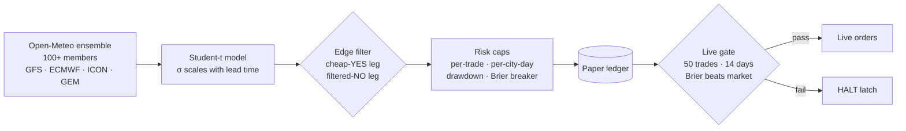

<div align="center">

<a href="https://github.com/codewithpom">
  
</a>

<br/>

<a href="https://txtutils.net/"></a>
<a href="https://twitter.com/padmashreejha"></a>
<a href="https://dev.to/codewithpom"></a>
<a href="https://www.kaggle.com/padmashreejha"></a>
<a href="mailto:codewithpom@gmail.com"></a>

<br/><br/>


</div>

---

## `~/whoami`

```console
padmashree@earth:~$ whoami
padmashree jha — full-stack builder, India

padmashree@earth:~$ cat now.txt
building   : TxtUtils (txtutils.net)  ← the side-hustle that became a product
shipping   : Smriti · CSES-Better · ChessCode · NDPify
researching: weather-market models, options-selling regimes, local-first search
stack      : TypeScript · Next.js · React · Python · Rust (curious) · Firebase · Cloudflare

padmashree@earth:~$ cat principles.txt
1. paper-trade before live-trade
2. fail closed, not open
3. if the backtest looks too good, the backtest is lying
4. free tiers are a design constraint, not an excuse

padmashree@earth:~$ ▌
```

---

## ⚡ What I'm building

| Project | What it is | Stack |
|---|---|---|
| **[TxtUtils](https://txtutils.net/)** | My product: a growing toolbox of text utilities, built as a side-hustle. | Next.js · React |
| **[Smriti](https://github.com/codewithpom/smriti)** · [live](https://smriti-gallery.pages.dev) | Crowd-curated school photo archive that runs entirely on free tiers. Face matching *proposes*, students *confirm*. Firebase Auth + Firestore rules, Cloudflare Pages/KV. | Python · Firebase · Cloudflare |
| **[CSES-Better](https://github.com/codewithpom/cses-better)** · [live](https://cses-better.vercel.app) | High-performance competitive-programming platform and judge for the CSES Problem Set: live submission sync, Monaco IDE, testbench, archive mirror. | TypeScript · Vercel |
| **[ChessCode](https://github.com/codewithpom/chesscode)** | Pipeline that turns a PGN (with variations) into a narrated chess-commentary video. | Python |
| **NDPify** | iOS app, live on the App Store. | Swift |
| **[Prabhananda Cup](https://prabhananda-cup-4th-edition.vercel.app)** | Live football-tournament site with realtime scores on Firebase Realtime DB. | TypeScript · Firebase |

<div align="center">

<a href="https://github.com/codewithpom/smriti"></a>
<a href="https://github.com/codewithpom/cses-better"></a>
<br/>
<a href="https://github.com/codewithpom/nifty-straddle-vix-router"></a>
<a href="https://github.com/codewithpom/dev-meme"></a>

</div>

---

## 🧪 Quant & Bots — research with guardrails

I build trading and prediction-market systems the slow, boring, honest way: **paper first, risk caps always, live only after the evidence clears a gate.** Most of this is private; here is how it works.

### 🌦️ Weather-market bot (paper trading)
Trades Polymarket's daily *"highest temperature"* bucket markets for **London, Seoul, NYC, Beijing and Miami**.



- **Model-cycle aware.** Runs 4×/day on GitHub Actions, timed to when NOAA/ECMWF forecasts actually publish, plus a 15-minute intraday position monitor that exits when observed temps breach a bucket.
- **Ground truth = official settlement stations** (ASOS via Iowa Mesonet), not a convenient proxy.
- **Fails closed.** Position, city-day and drawdown caps plus a rolling Brier-score circuit breaker trip a `HALT` latch. Live trading stays locked until paper results beat the market's own calibration.
- **Audits itself.** I diagnose losing trades (tail thickness, same-day blindness to live station maxima) and treat every fix as a hypothesis to paper-test, not a tweak to ship.

### 📈 [NIFTY straddle × VIX router](https://github.com/codewithpom/nifty-straddle-vix-router)
Systematic NIFTY / BANKNIFTY / SENSEX options-selling research: VIX-regime routing, walk-forward validation, and a write-up of **why the in-sample backtest lied**.

### 🎯 Polysniper
Short-timeframe Polymarket crypto bot: Dockerized, scheduled services with a **Telegram Mini App** front end.

---

## 🌍 Open source

| Project | ★ | What I did |
|---|---|---|
| **[sherlock-project/sherlock](https://github.com/sherlock-project/sherlock)** |  | Contributor — hunt social accounts by username across networks |
| **[yjid/kensaku](https://github.com/yjid/kensaku)** |  | Contributor — local-first Rust search with OCR, semantic search and MCP agent access |
| **[RKMV-CS/drama-soundboard](https://github.com/RKMV-CS/drama-soundboard)** |  | Contributor |
| **[RKMV-CS/Class-X-Farewell](https://github.com/RKMV-CS/Class-X-Farewell)** |  | Contributor |

Also on the shelf: [dev-meme](https://github.com/codewithpom/dev-meme) (27★ memes API), Twitter automation bots ([APOD](https://github.com/codewithpom/apod-twitter), [quotes](https://github.com/codewithpom/twitter-motivational-quotes)), [url-expander](https://github.com/codewithpom/url-expander).

---

## 🛠️ Stack

<div align="center">


</div>

---

## 📊 Stats

<div align="center">


<br/>


<br/>


</div>

---

<div align="center">

*"If the backtest looks too good, the backtest is lying."*


</div>
